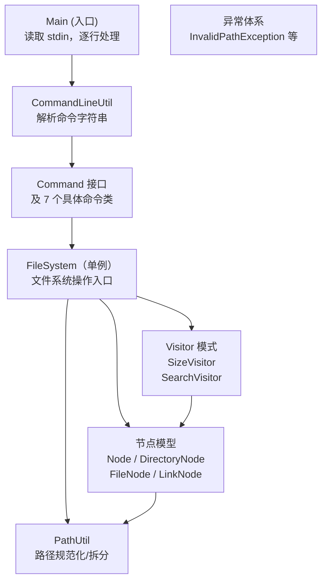
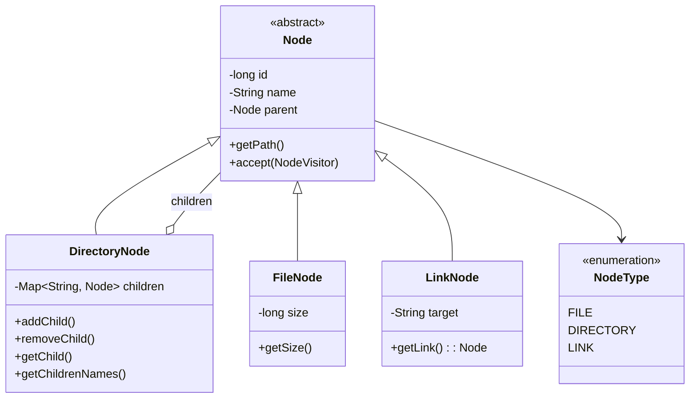
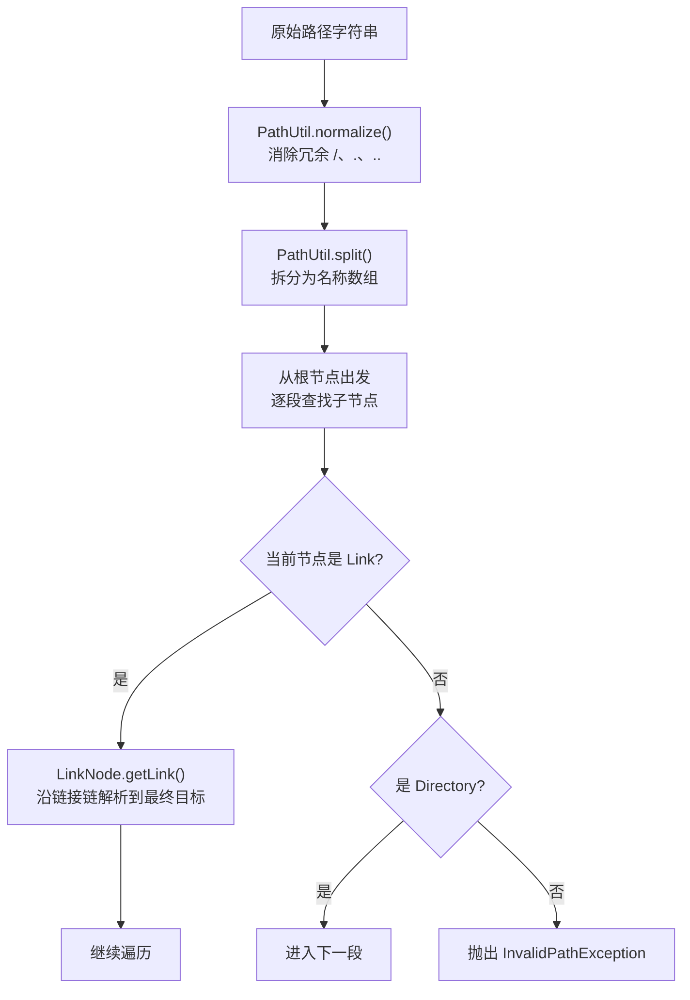
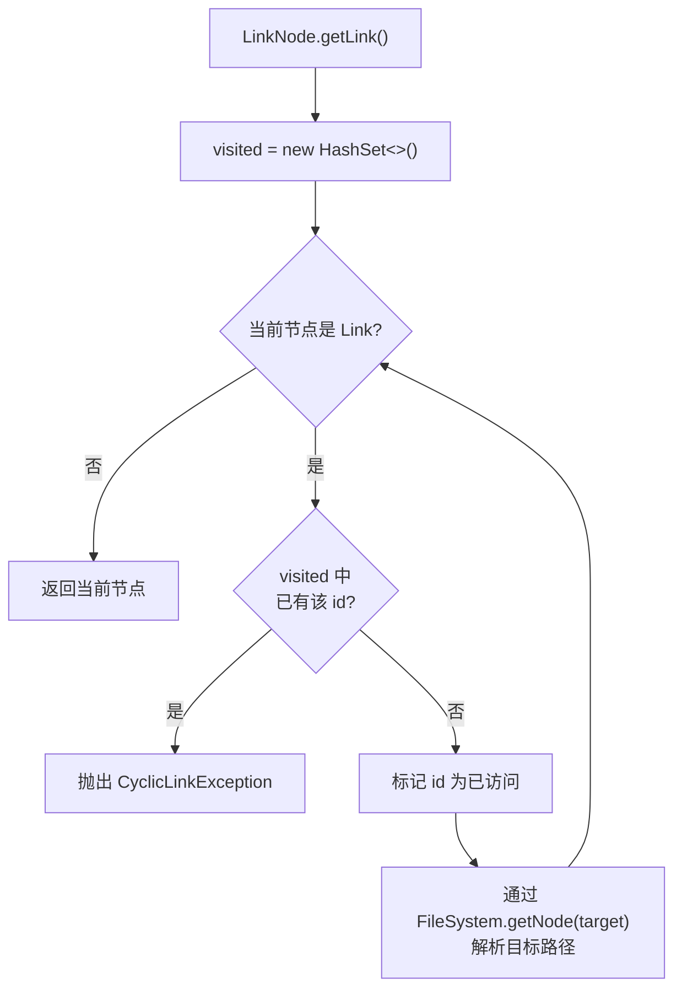

# 系统架构设计文档

## 1. 小组信息

- Gradescope 账号名： 何棋
- Gradescope 账号邮箱： 231250083@smail.nju.edu.cn
- 组员：
  - 231250083，何棋
  - 231250186，杨承岳
  - 231250148，吴同
  - 231250123，陈哲敏

## 2. 系统目标与范围

### 2.1 系统目标

系统旨在模拟一个极简的内存文件系统，支持常见的文件系统操作。

### 2.2 支持的命令

| 命令                  | 功能                                                                       |
| --------------------- | -------------------------------------------------------------------------- |
| `MKDIR <path>`        | 在 `path` 创建目录                                                         |
| `TOUCH <path> <size>` | 在 `path` 创建文件，大小为 `size`                                          |
| `LS <path>`           | 列出 `path` 下的所有直接子节点，按字典序排序                               |
| `INFO <path>`         | 输出 `path` 对应的总大小（文件大小 / 目录下所有文件总大小 / 链接目标大小） |
| `FIND <path> <name>`  | 在 `path` 下递归查找所有名称为 `name` 的节点，输出绝对路径                 |
| `RM <path>`           | 删除 `path` 指定的节点；目录非空则删除失败                                 |
| `LINK <path> <link>`  | 在 `link` 创建指向 `path` 的符号链接                                       |

### 2.3 路径规范

- 所有路径均为绝对路径，以 `/` 开头。
- 允许冗余 `/`，例如 `//usr///local` 等价于 `/usr/local`。
- 支持 `.`（当前目录）和 `..`（父目录）；根目录的父目录仍为根目录。
- 非根路径末尾允许 `/`，例如 `/usr/local/` 等价于 `/usr/local`。

### 2.4 节点类型

- **文件**：具有 `size` 属性，不能有子节点。
- **目录**：没有独立的大小属性，可以包含子节点。
- **链接**：没有大小属性，指向一个目标路径。访问链接时透明地解析到目标节点，共享其属性和子节点。

## 3. 核心架构

系统采用分层设计，从上到下依次为**入口层**、**命令层**、**文件系统核心层**和**工具层**。



### 3.1 命令解析与分发

命令层采用 **Command 设计模式**，将每个操作封装为独立的命令类。

```
Command（接口）
├── MakeDirectoryCommand   — MKDIR
├── TouchCommand           — TOUCH
├── ListCommand            — LS
├── InfoCommand            — INFO
├── FindCommand            — FIND
├── RemoveCommand          — RM
└── LinkCommand            — LINK
```

- **解析器** `CommandLineUtil.parse()` 读入一行文本，按空格分词后通过 `switch` 分发到对应的 Command 构造函数，返回 `Command` 实例。
- 每个 Command 的 `execute()` 方法调用 `FileSystem` 的静态方法完成实际操作，并直接向 `stdout` 输出结果。
- 这种设计使得添加新命令只需新增类并修改解析器的 `switch` 分支，无需改动其他模块。

### 3.2 文件系统核心模型

节点模型采用 **Composite 设计模式**，统一处理文件、目录和链接。



**关键设计说明：**

- **`Node`**：保存 `id`（全局唯一）、`name`、`parent` 引用。`getPath()` 递归拼接父路径得到绝对路径。
- **`DirectoryNode`**：使用 `TreeMap<String, Node>` 存储子节点，保证 `getChildrenNames()` 返回的列表按字典序排列。
- **`FileNode`**：增加 `size` 属性，是系统中唯一携带"大小"数据的节点。
- **`LinkNode`**：存储目标路径字符串，`getLink()` 方法解析目标路径并沿链接链追踪，使用 `HashSet<Long>` 记录已访问节点 ID 以检测循环链接。访问链接时，外部代码通常调用 `getLink()` 获取最终目标节点，从而实现透明解析。

### 3.3 Visitor 模式

系统使用 **Visitor 设计模式** 分离节点遍历逻辑与节点数据结构。基类 `NodeVisitor` 定义了三种访问方法：
- `visitFile`：访问文件节点。
- `visitDirectory`：访问目录节点。
- `visitLink`：访问链接节点。

基于 `NodeVisitor`，实现了两个具体访问者：

**`SizeVisitor`**：计算节点总大小。
- **文件**：累加 `size`。
- **目录**：递归访问所有子节点。
- **链接**：委托给目标节点（`target.accept(this)`），从而复用目标的访问逻辑。
- 使用 `visited` 集合标记已访问的节点 ID，防止循环链接导致无限递归。

**`SearchVisitor`**：按名称递归搜索节点。
- 遍历过程中维护当前路径，将匹配的路径加入结果列表。
- 遇到目录时递归访问每个子节点；遇到链接时既检查链接本身的名字，也进入链接目标目录继续搜索。
- 最终结果按字典序排序。

### 3.4 路径解析与规范化

`PathUtil` 工具类基于 Java 标准库 `java.nio.file.Path` 实现：

| 方法               | 功能                             |
| ------------------ | -------------------------------- |
| `normalize(path)`  | 去除冗余分隔符，解析 `.` 和 `..` |
| `isAbsolute(path)` | 判断是否为绝对路径               |
| `split(path)`      | 将路径拆分为各部分名称数组       |
| `join(parts...)`   | 拼接路径组件                     |
| `getParent(path)`  | 获取父路径                       |
| `getName(path)`    | 获取路径末端名称                 |

路径解析流程如下：



## 3.5 异常处理

系统定义了五个运行时异常类，继承自 `RuntimeException`：

| 异常类                             | 触发条件                                         |
| ---------------------------------- | ------------------------------------------------ |
| `InvalidPathException`             | 路径不是绝对路径、路径不存在、路径指向非目录节点 |
| `InvalidFileSizeException`         | 文件大小为负数                                   |
| `RemoveNonEmptyDirectoryException` | 试图删除非空目录                                 |
| `CyclicLinkException`              | 链接链中存在环                                   |
| `CommandLineParseException`        | 命令格式错误或未知命令                           |

所有异常在 `Main` 中被捕获（抛出时静默忽略），保证程序不会因单条命令错误而退出。

## 4. 关键数据结构

### 4.1 节点的统一标识

每个节点在创建时由 `FileSystem` 分配一个全局递增的 `long id`。该 ID 用于去重标记，确保不会导致重复遍历。

### 4.2 目录的子节点存储

`DirectoryNode` 内部使用 `TreeMap`存储子节点，保证了：
- **有序性**：`TreeMap` 按 key 的字典序排列，因此返回的列表天然有序，无需额外排序。
- **O(log n) 查找**：支持按名称快速查找子节点。

### 4.3 文件的大小存储

`FileNode` 在 `Node` 基础上增加 `long size` 字段：
- 文件是系统中唯一携带"大小"数据的节点。
- 目录和链接**不**存储大小——目录的大小由 `SizeVisitor` 实时递归计算得出，链接的大小则直接委托给目标节点计算。

### 4.4 链接的目标指向

`LinkNode` 不直接持有目标节点的 Java 引用，而是存储目标路径字符串，这带来了两个设计意图：
1. **区分"目录项名称"与"目标节点"**：`LinkNode` 自身的 `name` 是它在父目录中的条目名（例如 `myLink`），而 `target` 是它指向的目标路径（例如 `/usr/local`）。二者完全独立。
2. **延迟解析**：路径解析在调用 `getLink()` 时才发生。

## 5. 关键算法与边界处理

### 5.1 路径规范化

路径规范化委托给 `java.nio.file.Path.normalize()` 实现：

| 原始路径        | 规范化结果   | 处理方式                           |
| --------------- | ------------ | ---------------------------------- |
| `//usr///local` | `/usr/local` | 合并冗余 `/`                       |
| `/usr/./local`  | `/usr/local` | 消除当前目录 `.`                   |
| `/usr/bin/..`   | `/usr`       | 消除父目录 `..`                    |
| `/../usr`       | `/usr`       | 根目录的 `..` 被忽略（根无父目录） |

规范化是路径处理的第一步——所有命令在解析路径参数后都会先调用 `PathUtil.normalize()`，后续所有逻辑都在规范化后的路径上进行。

### 5.2 INFO 的大小计算与去重

`INFO` 命令通过 `SizeVisitor` 计算节点总大小。关键的去重机制：

- **文件**：累加 `size` 后标记为已访问。
- **目录**：标记为已访问后递归访问所有子节点。
- **链接**：不直接累加值，而是调用 `target.accept(this)` 委托给目标节点。
- **去重**：`SizeVisitor` 内部维护一个 `HashSet`，记录已访问的节点 ID。

### 5.3 FIND 的递归搜索与排序

`SearchVisitor` 从起始路径出发递归遍历：

- **目录**：遍历所有子节点，对每个子节点先进入（`child.accept(this)`），再递归其内容。
- **文件**：检查文件名是否匹配，若匹配则将当前路径加入结果列表。
- **链接**：既检查链接自身名称是否匹配，也通过 `getLink()` 解析到目标后继续遍历目标目录下的子节点。

**去重与排序**：
- 使用 `HashSet` 防止同一条路径通过多个链接被重复搜索，避免输出重复结果。
- 最终调用 `results.sort(String::compareTo)` 按字典序排序。

### 5.4 RM 的删除规则

| 目标类型       | 行为                                              |
| -------------- | ------------------------------------------------- |
| **文件**       | 直接从父目录中移除条目                            |
| **空目录**     | 直接从父目录中移除条目                            |
| **非空目录**   | 抛出 `RemoveNonEmptyDirectoryException`，拒绝删除 |
| **链接**       | 仅移除链接条目本身，不影响目标节点                |
| **根目录 /**   | 抛出 `InvalidPathException`，根目录不可删除       |
| **不存在路径** | 抛出 `InvalidPathException`                       |

### 5.5 覆盖语义

在同一路径上执行创建操作时，该路径已存在的节点类型决定行为：

| 操作              | 目标已存在     | 行为                 |
| ----------------- | -------------- | -------------------- |
| `MKDIR /p`        | 已存在目录     | 保持不变（静默成功） |
| `MKDIR /p`        | 已存在文件     | 文件被替换为目录     |
| `MKDIR /p`        | 已存在链接     | 链接目标被替换为目录 |
| `TOUCH /p <size>` | 已存在文件     | 更新文件大小         |
| `TOUCH /p <size>` | 已存在目录     | 目录被替换为文件     |
| `TOUCH /p <size>` | 已存在链接     | 链接目标被替换为文件 |
| `LINK /p /target` | 已存在任意节点 | 节点被替换为链接     |

覆盖本质上是通过 `addChild()` 向 `TreeMap` 写入相同 key 来实现——`TreeMap.put()` 会直接覆盖旧值。

### 5.6 链接解析与循环检测

`LinkNode.getLink()` 沿着链接链反复解析，直到遇到非链接节点：



- 使用 `visited: Set<Long>` 记录已访问过的节点 ID，一旦重复即判定为循环并抛出 `CyclicLinkException`。
- 解析过程中每一跳都调用 `FileSystem.getNode()` 重新走一遍路径查找流程，支持链式链接。


### 5.7 非法操作的处理

所有非法操作通过异常机制处理，在 `Main` 的顶层循环中被捕获并静默忽略：

```java
try {
    Command command = CommandLineUtil.parse(line);
    command.execute();
} catch (Exception e) {
    // 静默忽略，继续处理下一条命令
}
```

这种设计保证了程序面对任何错误输入都不会崩溃，始终可以继续处理后续命令。

## 6. 测试说明

测试覆盖三个测试类，按模块组织。

### 6.1 文件系统核心测试

包含 30+ 个测试用例，覆盖以下场景：

**基础操作与路径校验**
- 向不存在的父路径创建目录/文件 → 抛出 `InvalidPathException`
- 向文件下创建子节点 → 抛出 `InvalidPathException`
- 向根目录创建文件 → 抛出 `InvalidPathException`
- 创建负大小文件 → 抛出 `InvalidFileSizeException`

**覆盖语义**
- 在同一路径上依次创建文件/目录/链接，验证节点类型被正确替换
- 再次创建已存在的目录，验证 ID 保持不变（非重复创建）
- `TOUCH` 已存在的文件，验证大小被更新为新值
- `LINK` 已存在的节点，验证类型被替换为链接

**链接行为**
- 向不存在的目标创建链接 → 抛出 `InvalidPathException`
- 向不存在的父路径创建链接 → 抛出 `InvalidPathException`
- 向根目录创建链接 → 抛出 `InvalidPathException`

**LS 列表**
- 文件自身列表只返回自己的名称
- 目录列表按字典序返回子节点（`a.txt` 排在 `b.txt` 前）
- 链接到目录时，列表返回链接目标目录的子节点
- 链接到文件时，列表只返回链接自身的名称
- 不存在路径 → 抛出 `InvalidPathException`

**INFO 大小计算**
- 文件的 `sizeOf` 返回其大小
- 目录的 `sizeOf` 返回所有子文件大小之和
- 链接的 `sizeOf` 委托给目标节点（链接到文件返回文件大小，链接到目录返回目录总大小）
- 链接共享时的去重：两个链接指向同一文件，`sizeOf` 父目录只计一次

**FIND 搜索**
- 在文件或链接到文件上搜索时，仅检查起始节点自身
- 在目录上递归搜索，结果按字典序排序
- 链接到目录时，搜索穿透到目标目录的子节点
- 通过不同链接访问同一共享目录，搜索结果去重（不输出重复路径）
- 搜索同时返回链接自身名称及其目标目录中的同名子节点
- 不存在路径 → 抛出 `InvalidPathException`

**RM 删除**
- 删除文件后路径不可访问
- 仅删除链接条目，不影响目标节点
- 删除空目录后路径不可访问
- 删除非空目录 → 抛出 `RemoveNonEmptyDirectoryException`
- 删除不存在路径 → 抛出 `InvalidPathException`
- 删除根目录 → 抛出 `InvalidPathException`

### 6.2 路径工具测试

包含 13 个测试用例，覆盖以下场景：

**路径拼接**
- `join("/", "usr", "bin")` → `"/usr/bin"`（绝对路径拼接）
- `join(".", "src", "main")` → `"./src/main"`（相对路径拼接）
- `join(".", "src", "..", "test")` → `"./src/../test"`（join 不做规约，保留 `..`）

**路径拆分**
- `split("/usr/bin")` → `["usr", "bin"]`（绝对路径拆分，去掉根 `/`）
- `split("./src/main")` → `[".", "src", "main"]`（相对路径拆分）
- `split("./src/../test")` → `[".", "src", "..", "test"]`（split 不做规约，保留 `..`）

**路径规范化**
- `normalize("/src/../test")` → `"/test"`（解析 `..`）
- `normalize("//usr/local//")` → `"/usr/local"`（合并冗余 `/`）
- `normalize("/a//b/./c/../")` → `"/a/b"`（综合：合并 `/`、消除 `.`、解析 `..`）

**父路径获取**
- `getParent("/usr/local")` → `"/usr"`（正常路径）
- `getParent("/usr/")` → `"/"`（根目录作为父路径）
- `getParent("/")` → 抛出 `InvalidPathException`（根目录无父路径）

**名称提取**
- `getName("/usr/local")` → `"local"`（提取路径末端名称）

### 6.3 命令解析测试

包含 3 个测试用例，覆盖以下场景：

**正常解析**
- `"ls /usr/bin"` 解析为 `ListCommand`，路径为 `"/usr/bin"`（参数完整，正常解析）

**空格容错**
- `"  mkdir  /home/user  "` 解析为 `MakeDirectoryCommand`，路径为 `"/home/user"`（首尾和中间多余空格被正确处理）

**非法命令**
- `"unknowncommand"` → 抛出 `CommandLineParseException`（无法识别的命令关键字被拒绝）
